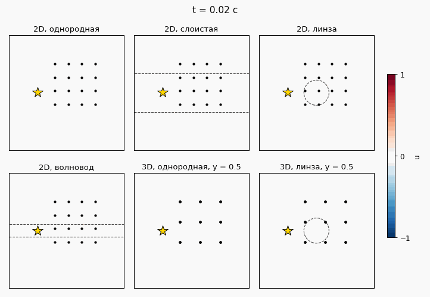

# Пространственно-временные ряды и SSA



## Структура

```text
notebooks/         ноутбуки 01–07: поля, данные и методы
code/
  waves/           физические модели, загрузка данных и проверки
  lag_ssa/         методы SSA и исследовательские эксперименты
  figures/         построение иллюстраций
  checks/          проверки математических формул
  build/           сборка документов
data/              исходные данные The Well и NOAA
results/           результаты экспериментов и иллюстрации ноутбуков
research/          математические тексты, заметки и исходники LaTeX
output/            временные файлы сборки
old/               прежние версии и отложенные концепции
scratch/           резервные копии и рабочие заметки
```

## Запуск

Из корня репозитория:

```bash
jupyter lab notebooks
python code/waves/real/fetch_tides.py
```

Описание методов и примеры запуска: [code/README.md](code/README.md).

## Математические тексты

- Фазовая реконструкция: [PDF](research/phase_ssa_method.pdf), [LaTeX](research/phase_ssa_method.tex).
- Спектральный конспект: [PDF](research/interpretation.pdf), [LaTeX](research/interpretation.tex).

Сборка через XeLaTeX и latexmk:

```bash
make -f code/build/research.mk
```
